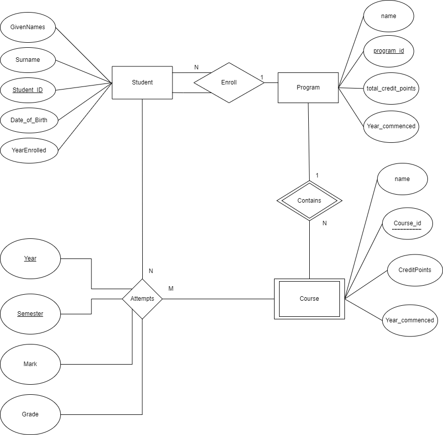

<h1 align="center">Databases 2022</h1>

<p align="center">
  <strong>A hands-on journey through data modeling, PostgreSQL, and MongoDB</strong>
</p>

<p align="center">
  <a href="#lab-overview">Labs</a> ·
  <a href="#skills-in-practice">Skills</a> ·
  <a href="#getting-started">Getting started</a>
</p>

<p align="center">
  
  
  
  
</p>

## Overview

A collection of laboratory assignments for the **Databases course at Innopolis University**. The repository follows the path from conceptual data modeling to SQL queries, indexing, server-side functions, and NoSQL document storage.

Each lab lives in its own directory and includes source code, diagrams, notes, or result screenshots. The labs are self-contained, so individual topics can be explored independently.

<p align="center">
  
  <br>
  <sub>Featured work: a university information system modeled using Chen notation</sub>
</p>

## Lab Overview

| Lab | Topic | Concepts and tools |
|---|---|---|
| [01](lab1/) | ER Modeling | Chen notation, entities, attributes, and relationships |
| [02](lab2/) | Enhanced ER Modeling | University domain modeling and cardinality constraints |
| [03](lab3/) | EER Modeling | Specialization, inheritance, hardware and software domains |
| [04](lab4/) | Relational Algebra | Projection, selection, joins, and set operations |
| [05](lab5/) | Relational Schema Design | DDL, primary and foreign keys, table relationships |
| [06](lab6/) | SQL Queries | `JOIN`, `DISTINCT`, filtering, and window functions |
| [07](lab7/) | Data Aggregation | `GROUP BY`, `SUM`, sorting, and top-result queries |
| [08](lab8/) | Query Performance | `EXPLAIN`, Hash and B-tree indexes, execution plan comparison |
| [09](lab9/) | PostgreSQL + Python | PL/pgSQL, `psycopg2`, and geocoding with Nominatim |
| [10](lab10/) | Bank Account Schema | Database schema design and seed data |
| [11](lab11/) | MongoDB | CRUD operations, filters, embedded documents, and arrays |

## Skills in Practice

- **Data modeling:** translating domain requirements into ER and EER diagrams.
- **Relational design:** building schemas and expressing queries through relational algebra.
- **Practical SQL:** using joins, aggregate and window functions, and integrity constraints.
- **Query optimization:** creating indexes and comparing execution plans.
- **Application integration:** calling PostgreSQL functions from Python and processing external data.
- **NoSQL development:** performing CRUD operations on MongoDB documents.

## Getting Started

Prerequisites vary by lab:

- **PostgreSQL** for SQL and PL/pgSQL scripts;
- **Python 3** for the database integration examples;
- **MongoDB** for `lab11` only.

Run a SQL script with `psql` after selecting an appropriate database:

```bash
psql -d database_name -f lab6/ex1.sql
```

To run the MongoDB example:

```bash
python3 -m venv .venv
source .venv/bin/activate
python -m pip install pymongo
python lab11/ex1.py
```

For `lab9`, install `psycopg2-binary` and `geopy`, then restore the included `dvdrental` database. For `lab11`, populate MongoDB with sample documents in the `restaurants` collection.

> These are educational examples designed for a local environment. Update the PostgreSQL and MongoDB connection settings before running the Python scripts.

---

<p align="center">
  <sub>Innopolis University · Databases Course · 2022</sub>
</p>
